# Mobile UI Labs

Dix petits labs Compose Multiplatform (Android + iOS), chacun consacré à une décision UX précise :
où placer un feedback, quand passer d'une navigation basse à un rail, que dire quand l'écran est vide,
comment demander une permission sans casser la confiance...

Le but n'est pas de livrer des apps complètes, mais de rendre ces décisions visibles et manipulables :
chaque lab compare plusieurs patterns côte à côte, avec des onglets pour passer de l'un à l'autre et une
« règle » qui résume l'arbitrage. Les dix labs sont réunis dans une seule application, derrière un écran
d'accueil qui les liste.

<p align="center">
  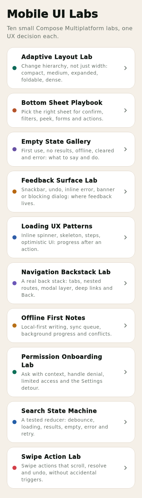
</p>

## Les labs

### Adaptive Layout Lab

Un layout adaptatif n'est pas une grille qui s'étire : c'est une décision de hiérarchie. Le lab montre la même
expérience en compact (navigation basse), medium (rail), expanded (liste + détail), pliable (séparation physique)
et dense. Les cinq dispositions sont des maquettes commentées ; un curseur de largeur fait basculer la maquette
de la navigation basse au rail puis à liste + détail aux seuils de 600 et 840 dp. Ce n'est pas encore un vrai
layout qui réagit à la taille de la fenêtre.

<p align="center">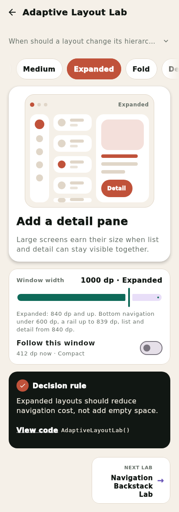</p>

### Bottom Sheet Playbook

Une bottom sheet est un outil de focus temporaire, pas une page cachée. Cinq usages réalistes (confirmation,
filtres, aperçu partiel, formulaire court, actions secondaires) s'ouvrent dans une vraie `ModalBottomSheet`
pour comparer hauteur, contenu et niveau de friction.

<p align="center">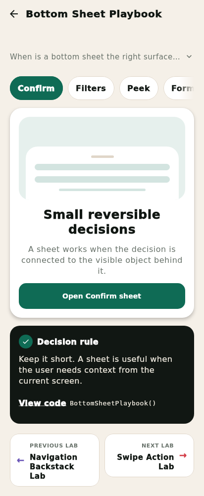</p>

### Empty State Gallery

Un écran vide est un moment de décision : rassurer, expliquer, proposer la suite sans culpabiliser. Premier usage,
recherche sans résultat, hors ligne, permission manquante et erreur récupérable ont chacun leur texte produit ;
les boutons mènent vraiment quelque part (chargement simulé puis liste remplie, ou accusé de réception).

<p align="center">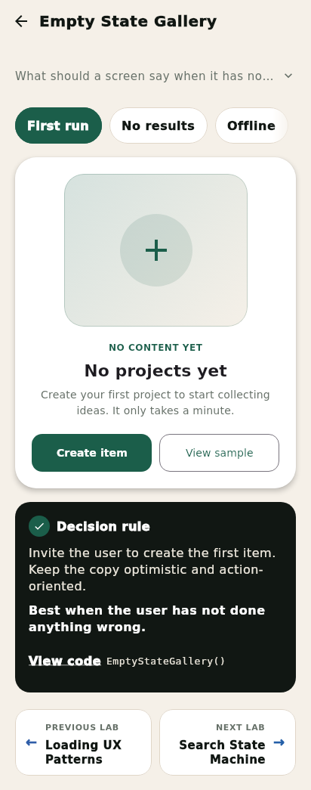</p>

### Feedback Surface Lab

Tous les messages n'ont pas besoin d'interrompre. Snackbar, undo, erreur inline, bannière ou dialogue bloquant :
chaque bouton déclenche la vraie surface (snackbar qui disparaît seule, UNDO qui restaure, bannière persistante,
dialogue avec action de reprise) pour comparer friction et hiérarchie.

<p align="center">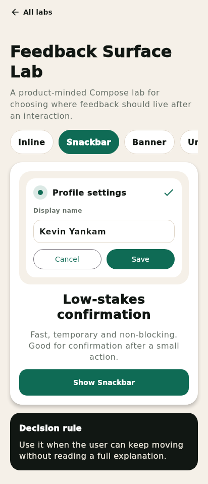</p>

### Loading UX Patterns

Un loader n'est pas qu'un spinner. Chargement dans le bouton, overlay de soumission, skeleton, feedback optimiste
et progression par étapes se rejouent d'un appui, du chargement jusqu'à la confirmation.

<p align="center">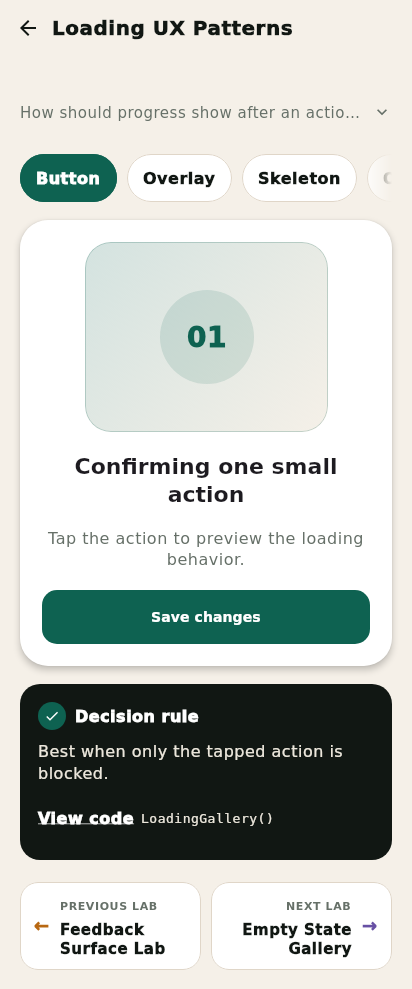</p>

### Navigation Backstack Lab

La navigation est invisible jusqu'au jour où Back surprend. Le lab tient une vraie pile par onglet (Home / Inbox)
plus une couche modale : « Open next », « Share », « Deep link » (chemin de retour reconstruit) et Back, y compris
le Back système Android. Le visualiseur affiche la pile réelle et la prochaine destination de Back. Modèle pur
couvert par `BackstackTest`.

<p align="center">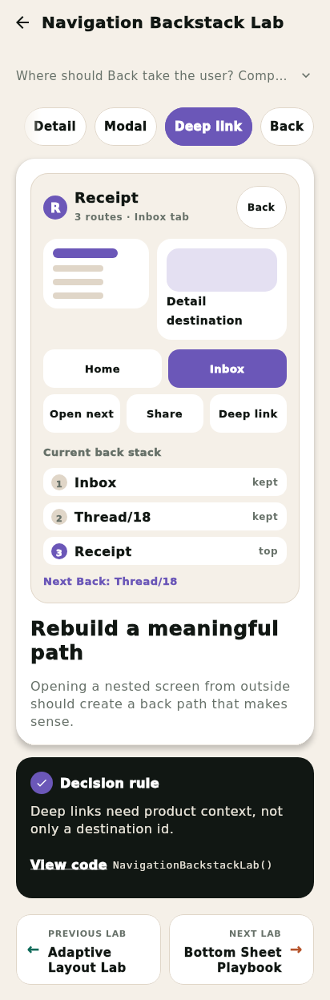</p>

### Offline First Notes

Offline-first est une promesse produit : la note est déjà en sécurité, on voit ce qui reste à synchroniser, on peut
continuer à écrire, et un conflit se résout avec son contexte. La note est jouable : écrire une ligne l'enregistre
sur l'appareil et la met en file, « Go offline » coupe le réseau sans bloquer l'écriture, « Sync now » pousse la file
vers un serveur simulé, et une modification faite « sur un autre appareil » provoque un conflit à résoudre (garder la
mienne, la leur, ou les deux). Reducer pur couvert par `NotesSyncTest` ; rien n'est persisté.

<p align="center">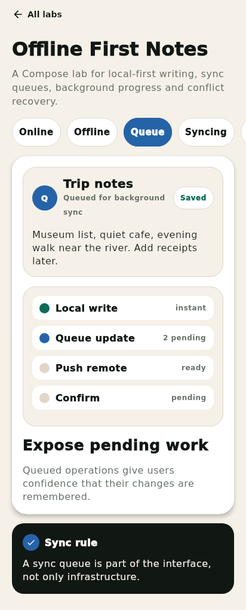</p>

### Permission Onboarding Lab

Une permission est un moment de confiance. Le parcours est jouable de bout en bout sur une permission simulée :
valeur, explication, dialogue système, refus doux, accès limité, deuxième refus qui bloque, détour par les Réglages
puis accès accordé. Machine à états pure couverte par `PermissionFlowTest`.

<p align="center">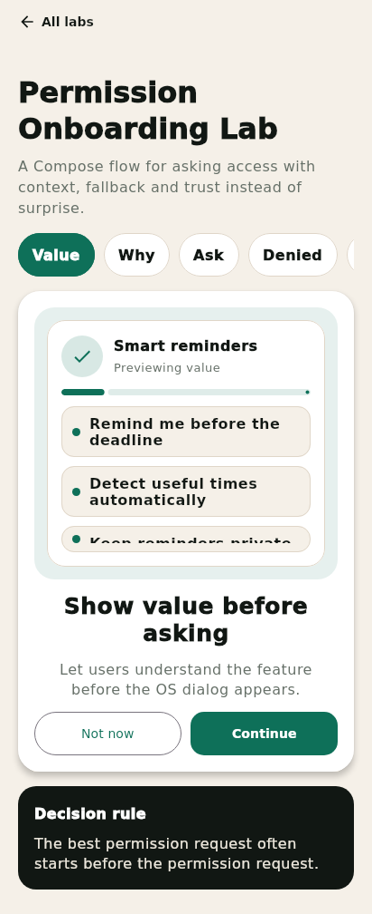</p>

### Search State Machine

Une recherche, c'est une suite d'états qui doivent garder l'intention vivante. Un vrai champ de saisie alimente un
reducer : debounce (350 ms, 3 lettres), chargement, résultats, vide avec pistes de reprise, erreur avec Retry, et
réponses obsolètes ignorées. Reducer pur couvert par `SearchMachineTest`.

<p align="center">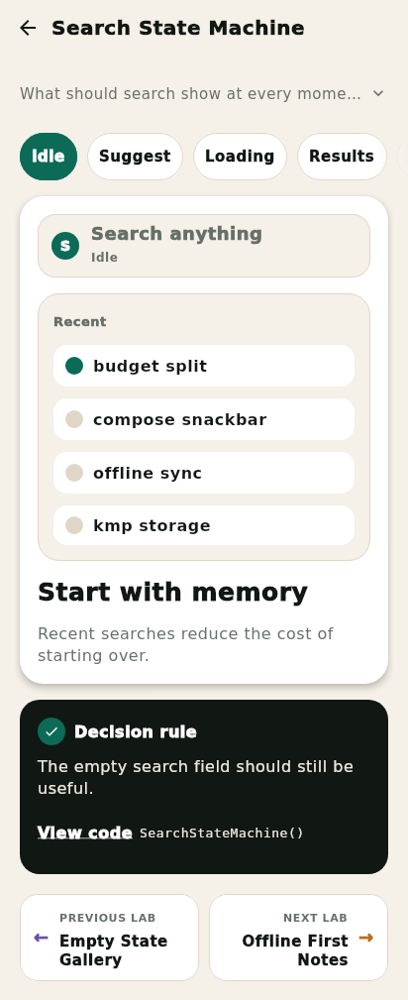</p>

### Swipe Action Lab

Un swipe est un raccourci qui peut vite devenir ambigu. Les cartes se balaient horizontalement sans bloquer le
défilement vertical, révèlent l'action, la déclenchent au-delà d'un seuil en dp, puis proposent UNDO dans une
snackbar.

<p align="center">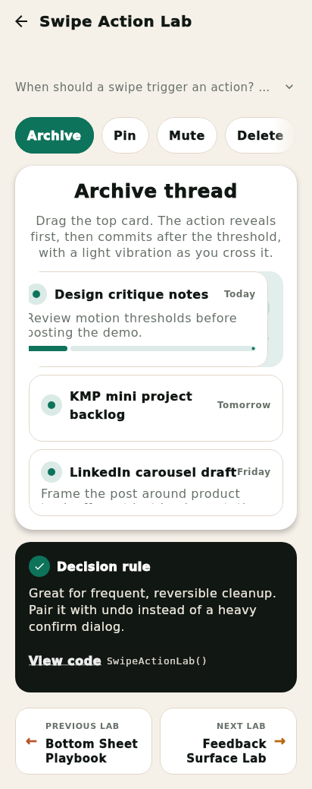</p>

## Organisation du code

```
composeApp/   l'application : écran d'accueil (com.kevin.labs) et un package par lab (com.kevin.<lab>)
lab-ui/       ce qui est commun à toute la série : palette, LabTheme, LabHeader, LabTabs (onglets
              accessibles : rôle Tab, état sélectionné, 48 dp), RuleCard, StatusDot, SystemBackHandler
iosApp/       projet Xcode qui embarque le framework ComposeApp
```

Chaque lab reste un fichier `App.kt` autonome (plus son modèle pur et ses tests quand il en a) : on peut le lire
sans connaître le reste du dépôt.

## Lancer

Prérequis : JDK 17+ et un SDK Android (`ANDROID_HOME`).

```bash
./gradlew :composeApp:assembleDebug          # APK Android : composeApp/build/outputs/apk/debug/
./gradlew :composeApp:installDebug           # sur un appareil ou un émulateur connecté
./gradlew :composeApp:testDebugUnitTest      # tests commonTest (backstack, permission, recherche)
./gradlew :composeApp:compileKotlinIosArm64  # vérifie le code Kotlin iOS, même sans Mac
```

iOS : ouvrir `iosApp/iosApp.xcodeproj` dans Xcode (sur macOS) et lancer la cible `iosApp` ; la phase de build
appelle `./gradlew :composeApp:embedAndSignAppleFrameworkForXcode`. Renseigner `TEAM_ID` dans
`iosApp/Configuration/Config.xcconfig` pour un appareil réel.

La CI (`.github/workflows/build.yml`) construit l'APK debug et lance les tests à chaque push et pull request.

## Licence

Aucune licence n'est fournie pour l'instant (choix de l'auteur) : sans licence explicite, le code reste
« tous droits réservés ».
